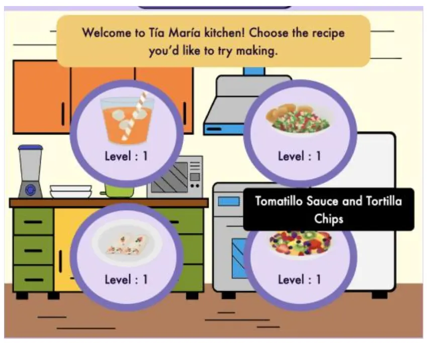
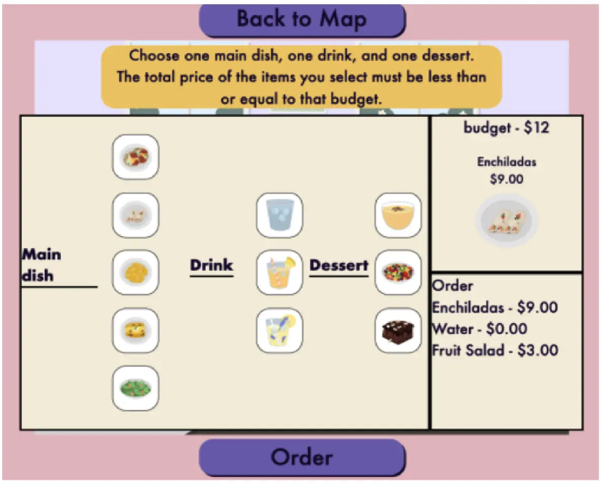

# I Apply Math In My World

A web-based math game built for a PhD research project, designed to help Latinx elementary-aged students practice everyday math in real-life scenarios and reduce math anxiety.

The research study has concluded and the database is no longer active, so the [live demo](https://iapplymath.vercel.app) is not functional.

## Screenshots

| Aunt's House Level | Restaurant Level |
|---|---|
|  |  |

## About

This project was built to support doctoral research on reducing math anxiety in elementary students through interactive, real-world scenario-based gameplay.

The work supported Dr. Luz Elizabeth Robinson's dissertation at UNC Chapel Hill, available through the [Carolina Digital Repository](https://cdr.lib.unc.edu/concern/dissertations/q524k395x).

## Tech Stack

- **Frontend:** React, Redux (Redux Toolkit), Next.js
- **Backend:** MongoDB, Next.js API routes
- **Other:** SWR, Framer Motion, Sass

## Getting Started

1. Clone the repo:
   ```
   git clone https://github.com/luzeli29/iapplymath.git
   ```
2. Install dependencies:
   ```
   npm install
   ```
3. Run the dev server:
   ```
   npm run dev
   ```
4. Build for production:
   ```
   npm run build
   ```

> This project is no longer under active development. The instructions above are for exploring or running the code locally.

## Contributors

This project was built by an awesome 6-person development team:

- [John Le Houillier](https://github.com/johnleh)
- [Santos Lopez-Lucas](https://github.com/slopezlucas)
- [Karen Gonzalez-Palomo](https://github.com/karengpalomo)
- [Pablo Escobar](https://github.com/esc20936)
- [Kristen Brandt](https://github.com/KristenBrandt)
- [Angel Higueros](https://github.com/angelhigueros)

## Contact

Questions about the project or codebase? Reach out at [john.lehouillier@gmail.com](mailto:john.lehouillier@gmail.com).